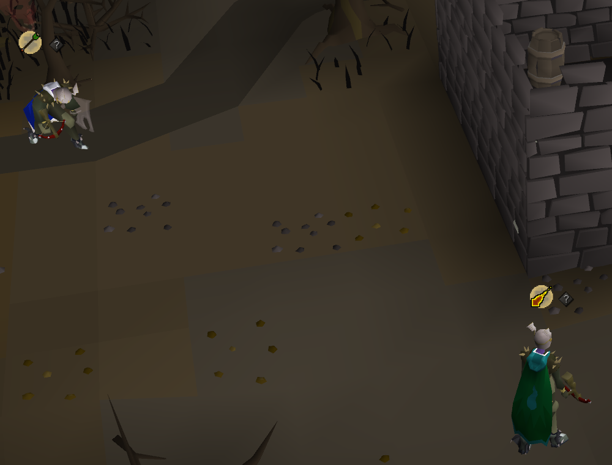
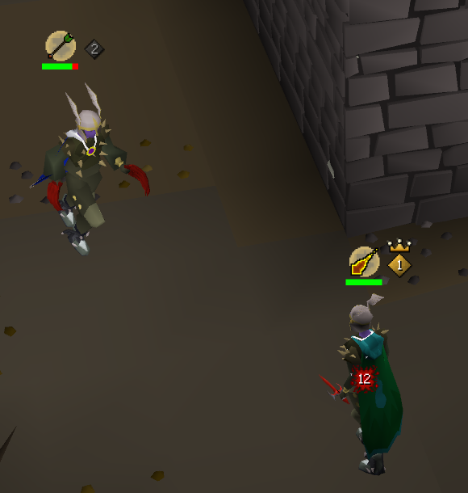

**Stop tracking PID in your head. See who goes first, live, beside your health bar, and enjoy the fight.**

| | Beside a health bar | What it means | What to do |
|:---:|---|---|---|
|  | **Gold diamond with a crown and a 1** | This player has PID. When you both attack on the same tick, their hit lands first. | If it's you, you win the tick. Spec, stack your hits and go for the KO when they're low. If it's them, don't trade specs at low hitpoints, eat up first. |
|  | **Grey diamond with a 2** | This player doesn't have PID. Their hit lands a tick late. | If it's you, don't trade hits at KO range. Eat to safety and wait for the swap. |
|  | **1? and 2?** | The game may reroll PID any moment. | Don't commit a spec on who has it right now. |
|  | **Grey diamond with a ?** | Nothing has been read yet. | Land a hit and it reads it. |

---

I was watching Ian ([PureSpam](https://www.youtube.com/@PureSpam)) and he was constantly talking about PID. I had PK'ed in the wilderness for years but never heard of it, but turns out it's the secret to the highest skilled and most effective PvP gameplay. So I tried learning about it, but it never stuck. So I made a plugin to visualize it.

**If PID has ever cost you a fight, give it a ⭐ so other PKers find it.**

---

## What is this?

Like a freeze timing indicator, or showing the game ticks, we show a small icon next to your character that shows if you or your opponent have PID, which means you will hit first when you attack at the same time.

## Killful and boring af tbh

Mentally tracking with memory isn't how I like to PK. I get that I'm lazy and not skillful but like, I will get the same results and be less bored. The idea is that there are things that the game makes not fun, which is stuff to track with memory. This lets you focus on the flow state and fun of the game, to enjoy PKing again and get more skillful about learning the game engine.

## What you'll see

While you're fighting another player, a small diamond sits beside your health bar and theirs, cut from the same stone as the game's own tab buttons. It never covers your prayers, skull or overheads, and it's gone the moment the fight is.

---

## Install

### From the Plugin Hub (one click, inside RuneLite)

The plugin has been [submitted to the RuneLite Plugin Hub](https://github.com/runelite/plugin-hub/pull/18830). Once it's accepted, open RuneLite, click the **Plugin Hub** icon in the sidebar, search **PID Indicator** and click **Install**. That's it.

### Right now, from this page

Download `pid-indicator.jar` from the [latest release](https://github.com/DrThomasAger/pid-indicator/releases/latest), put it in `.runelite/sideloaded-plugins` in your home folder, and start RuneLite with `--developer-mode` ([how to do that with a Jagex account](https://github.com/runelite/runelite/wiki/Using-Jagex-Accounts)).

---

## FAQ

### How does it know?

Every attack takes its own time to land, set by the weapon in the attacker's hands, and when the defender has PID the hit lands one tick late. The plugin watches every attack and every hit, yours and theirs, and puts the answer beside your health bars as the fight happens. You never have to trade hits on purpose to find out.

### Isn't reading PID part of the skill?

Yes, and that's exactly why it's worth learning. The best PKers read PID by feel, built up over thousands of fights, holding it in memory while they fight. That memory work is the part the game makes no fun. With the crown beside your bar you can let it go and put your attention on the fight itself, the flow of it, and on learning how the game engine really works. The skill was never in squinting at hitsplats. It's in knowing when to go for the KO and when to eat up, and you still make every one of those calls yourself.

It also teaches. Fight with it for a while and you'll start to feel PID before the crown moves. Then you can switch it off and keep the instinct.

### Isn't this just another cringe overlay?

It's two small diamonds, and they only exist while you're fighting another player. There are no boxes, no panels and no text. They sit where your eyes already are during a fight, beside the two health bars that matter.

### Why does PID matter so much?

With PID your hits land first and your steps happen first. When you both go for the KO at the same moment, yours counts first. PKers who know who has PID go for the KO when they have it and eat up when they don't.

### What if PID changes mid-fight?

The game rerolls PID at random every minute or so, faster on PvP worlds. When that moment arrives, the diamonds read 1? and 2?, so you see it coming before it happens.

### Which weapons does it read?

All of them, including weapons that come out after this plugin. It reads the weapon in each player's hands straight from the game's own item data, which says whether it's a melee weapon, a bow, a crossbow, a thrown weapon, a chinchompa, a ballista or a staff, and each of those lands its hit after a known number of ticks. A weapon released tomorrow carries that from the day it comes out, so there's nothing to update.

### Where does it work?

Anywhere you fight another player. That covers Last Man Standing, the Wilderness, PvP worlds, the PvP Arena, NH and pure fights, tribrid and single style.

### Is it allowed?

It only reads what your own client already shows you, meaning the attacks and hits of you and your opponent and the weapons in your hands. It sends nothing anywhere, never clicks, never acts for you and changes nothing in the game.

### I want to learn PID properly. Where do I start?

Watch [PureSpam](https://www.youtube.com/@PureSpam) fight. He talks about it constantly, which is how this plugin started. [Dalbix's PID guide](https://www.youtube.com/watch?v=mCnN9cqro5g) walks through it with examples. Then turn this plugin on and watch the crown while you fight.

---

## Settings

**Mark when PID may change** shows 1? and 2? once the game may reroll PID.

---

## Take part

This gets sharper with every fight people play with it. Star the repository so other PKers find it. If the crown sat on the wrong player, [report it](https://github.com/DrThomasAger/pid-indicator/issues/new?template=wrong-pid.yml), and a short clip is gold. Fork it and build on it, see [CONTRIBUTING.md](CONTRIBUTING.md), it takes three commands to build, test and run.

PID has decided fights in the dark for years. Let's turn the lights on together.

---

Made by **Dr. Thomas Ager** while playing Last Man Standing · BSD 2-Clause, the same licence as RuneLite

