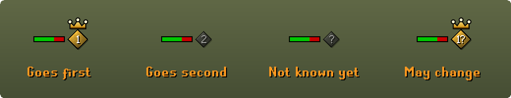

# PID Indicator

**Stop guessing who has PID. See it, live, over both your heads.**



Every PKer knows PID decides fights. Whoever has it gets their actions in first each tick. Their hit lands sooner, their step happens before yours, and when you both go for the KO at the same moment, theirs counts first. Until now you couldn't see any of that. You had to guess.

PID Indicator puts a diamond over your head and over your opponent's. **Gold with a crown means that player has PID. Grey means they don't.**

---

## What you'll see

| Over a player | What it means | What to do |
|---|---|---|
| **Gold diamond with a crown**, `PID safe` | This player has PID, and it can't change hands yet. | If it's you, this is your window, so push. If it's them, play safe and wait it out. |
| **Grey diamond**, `no swap yet` | This player doesn't have PID, and won't get it back soon. | If it's you, don't take even trades now. Wait for the swap. |
| **Either diamond**, `can swap now` | PID can be redrawn at any moment. | Watch the crown. It might jump. |
| **Grey diamond over you**, `hit to learn` | The plugin hasn't seen enough yet. | Land a hit and it will know. |

---

## The problems it solves

### "Do I even have PID right now?"

Most players find out after the fight, from a clip, or never. Some burn hitpoints testing it, trading hits and squinting at hitsplats.

**The plugin reads it from your fight as it happens.** Every attack has its own travel time, and when the defender has PID, the hit lands one tick late. The plugin watches every attack and every hit, yours and theirs, and puts the answer over your heads. Melee, crossbows, bows, darts, knives, the blowpipe, barrage and other spells all count. You never have to trade hits on purpose to find out.

### "I went all in and they had PID."

You stack your spec, they eat, and their hit lands first. PID decided that exchange and you never saw it coming.

**A gold crown over you means go.** With PID your hits land first, which is your window to push. With the crown over them, you know they act first, so you can hold back until it swaps.

### "PID swapped mid-fight and I didn't notice."

The game redraws PID at random every minute or so, and faster on PvP worlds. An advantage you had a moment ago can be gone now.

**The label tells you when it can change.** `PID safe` means it can't swap yet. `can swap now` means it might jump any moment. You'll see your advantage ending before it ends, and can plan your next push for the next window.

### "I keep losing the trades I should win."

Two equal players trade hits, and one keeps coming out ahead. More often than people think, the difference is PID, not skill.

**Now you can see it and learn from it.** Notice which fights you win with the crown over you and which you lose without it. You'll start to feel when to commit and when to wait.

### "Does it work where I fight?"

**Anywhere you fight another player.** That covers Last Man Standing, the Wilderness, PvP worlds, the PvP Arena, NH and pure fights, tribrid and single-style. It reads both of you from the moment either of you attacks.

### "Every PID tool is a guess."

Most of what's out there is forum rules of thumb.

**This one was built from real fights.** The method came from studying a large set of recorded Last Man Standing fights, hit by hit. When it isn't sure, it doesn't pretend. It shows a grey diamond and `hit to learn`.

---

## What it does and doesn't do

- It only reads what your own client already shows you, meaning the attacks and hits of you and your opponent.
- It sends nothing anywhere and talks to no server.
- It never clicks, never acts for you, and changes nothing in the game. It draws two diamonds and a word.

## Settings

- **Show outside fights.** Keeps your own diamond over your head in PvP places (the Wilderness, PvP, Last Man Standing, high risk and Deadman worlds) even when you aren't fighting.
- **Show swap labels.** The words under each diamond.

---

## Take part, and make it better

This is the first version, and it gets sharper with every fight people play with it. Here's how you can help.

1. **Run it in your fights.** Build it (see below) or grab the jar from [Releases](https://github.com/DrThomasAger/pid-indicator/releases) and load it in RuneLite's developer mode.
2. **Tell us when it's wrong.** If the crown sat over the wrong player, [open an issue](https://github.com/DrThomasAger/pid-indicator/issues). Say roughly what happened, which weapons were out, and where you were fighting. A short clip is gold.
3. **Bring your weapons.** It knows the attacks seen in a large set of recorded fights, from the whip, claws, godswords and mauls to crossbows, bows, darts, knives, the blowpipe and barrage. If your weapon never moves the crown, tell us, or add its animation yourself in [`PidTracker.java`](src/main/java/com/drthomasager/pid/PidTracker.java).
4. **Star the repository** so other PKers can find it.
5. **Pull requests are welcome.** The tracker is plain Java with its own tests in `src/test`.

PID has decided fights in the dark for years. Let's turn the lights on together.

---

## Building

```
./gradlew build
```

`./gradlew run` starts RuneLite in developer mode with the plugin loaded. The jar lands in `build/libs`.

## Where it comes from

Written by Dr. Thomas Ager while playing Last Man Standing, as part of a set of fight aids built and checked against his own recorded fights.

## Licence

BSD 2-Clause, the same licence as RuneLite. See [LICENSE](LICENSE).
