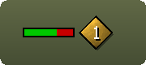
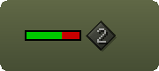
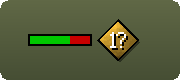
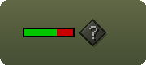

<div align="center">

# PID Indicator

**Stop tracking PID in your head. See who goes first, live, over both your heads, and enjoy the fight.**

[](https://github.com/DrThomasAger/pid-indicator/stargazers)
[](https://github.com/DrThomasAger/pid-indicator/fork)
[](https://github.com/DrThomasAger/pid-indicator/releases/latest)
[](https://github.com/DrThomasAger/pid-indicator/actions)
[](LICENSE)

</div>

---

I was watching Ian ([PureSpam](https://www.youtube.com/@PureSpam)) and he was constantly talking about PID. I had PK'ed in the wilderness for years but never heard of it, but turns out it's the secret to the highest skilled and most effective PvP gameplay. So I tried learning about it, but it never stuck. So I made a plugin to visualize it.

— Dr. Thomas Ager

<div align="center">


**If PID has ever cost you a fight, give it a ⭐ so other PKers find it.**

</div>

---

## Every PKer has been here

- **You trade hit for hit with someone your level, and they keep coming out ahead.** You never find out why.
- **You stack your spec, they eat, and their hit lands first.** PID decided it, and you never saw it coming.
- **You had the edge a minute ago, and now you don't.** The game handed PID over mid-fight and nothing told you.
- **You burn hitpoints testing who goes first.** You trade hits on purpose and squint at hitsplats.
- **You've read the guides and watched the videos.** It still won't stick when the fight is on.

## What you'll see

A small diamond sits beside your health bar and your opponent's, cut from the same stone as the game's own tab buttons. It never covers your prayers, skull or overheads.

| | Over a player | What it means | What to do |
|:---:|---|---|---|
|  | **Gold stone diamond with a 1**, beside the health bar | This player goes first. Their hits land first and their steps happen first. | If it's you, push. If it's them, play safe. |
|  | **Grey stone diamond with a 2** | This player goes second. | If it's you, avoid even trades and wait. |
|  | **1? and 2?** | The game can hand PID to the other player at any moment. | Watch the crown. It might jump. |
|  | **Grey stone diamond with a ?** | Nothing has been read yet. | Attack, and it will know. |

---

## Install

### From the Plugin Hub (one click, inside RuneLite)

The plugin has been [submitted to the RuneLite Plugin Hub](https://github.com/runelite/plugin-hub/pull/18830). Once it's accepted, open RuneLite, click the **Plugin Hub** icon in the sidebar, search **PID Indicator** and click **Install**. That's it.

### Right now, from this page

1. Download `pid-indicator.jar` from the [latest release](https://github.com/DrThomasAger/pid-indicator/releases/latest).
2. Put it in `.runelite/sideloaded-plugins` in your home folder.
3. Start RuneLite with `--developer-mode` ([how to do that with a Jagex account](https://github.com/runelite/runelite/wiki/Using-Jagex-Accounts)).

---

## FAQ

### How does it know?

Every attack takes its own time to land, and when the defender has PID, the hit lands one tick late. The plugin watches every attack and every hit, yours and theirs, and puts the answer over your heads as the fight happens. You never have to trade hits on purpose to find out.

### Isn't reading PID part of the skill?

Yes, and that's exactly why it's worth learning. The best PKers read PID by feel, built up over thousands of fights, holding it in memory while they fight. That memory work is the part the game makes no fun. With the crown over your heads you can let it go and put your attention on the fight itself, the flow of it, and on learning how the game engine really works. The skill was never in squinting at hitsplats. It's in knowing when to push and when to wait, and you still make every one of those calls yourself.

It also teaches. Fight with it for a while and you'll start to feel PID before the crown moves. Then you can switch it off and keep the instinct.

### Isn't this just another cringe overlay?

It's two small diamonds. There are no boxes, no panels and no text. Outside a fight it shows only your own diamond, and you can switch even that off. It sits where your eyes already are during a fight, over the two heads that matter.

### Why does PID matter so much?

With PID your hits land first and your steps happen first. When you both go for the KO at the same moment, yours counts first. Players who know who has PID push when they have it and hold back when they don't.

### What if PID changes mid-fight?

The game hands PID out again at random every minute or so, faster on PvP worlds. When that moment arrives, the diamonds read 1? and 2?, so you see it coming before it happens.

### Which weapons does it read?

All of them, including weapons that come out after this plugin. It learns from the game itself. Every attack in the game lands on one of a handful of timing rules, so each time someone swings, shoots or casts and their hit lands, the plugin notes which rule it fits. After a few hits it knows the weapon. Eating, blocking and casting Vengeance never fit a rule, so they never count.

It starts out already knowing the weapons seen across a large set of recorded fights. That includes the whip, claws, dragon dagger, godswords, mauls, the fang, crossbows, bows, the ballista, javelins and spells.

### Can I see what it has learned?

Yes. Everything it knows is in a plain text file called `attacks.txt`, one weapon per line, showing its animation, its timing rule, how many hits it was learned from and the weapon's name. It lives in the plugin's folder inside your `.runelite` folder, and you can read it, share it or edit it.

```
4230   | bow      | 1 + (3 + distance) / 6     |  7426/8223  | Dragon crossbow
1658   | melee    | 0                          |  1924/1959  | Abyssal whip
7516   | melee    | 0                          |    36/37    | Elder maul
```

### Where does it work?

Anywhere you fight another player. That covers Last Man Standing, the Wilderness, PvP worlds, the PvP Arena, NH and pure fights, tribrid and single style.

### Is it allowed?

It only reads what your own client already shows you, meaning the attacks and hits of you and your opponent. It sends nothing anywhere, never clicks, never acts for you and changes nothing in the game.

### I want to learn PID properly. Where do I start?

Watch [PureSpam](https://www.youtube.com/@PureSpam) fight. He talks about it constantly, which is how this plugin started. [Dalbix's PID guide](https://www.youtube.com/watch?v=mCnN9cqro5g) walks through it with examples. Then turn this plugin on and watch the crown while you fight.

---

## Where this is going

Mentally tracking with memory isn't how I like to PK. The idea is that there are things that the game makes not fun, which is stuff to track with memory. This lets you focus on the flow state and fun of the game, to enjoy PKing again and get more skillful about learning the game engine.

— Dr. Thomas Ager

---

## Take part

This gets sharper with every fight people play with it.

- ⭐ **Star the repository** so other PKers find it.
- 🐛 **Crown on the wrong player?** [Report it](https://github.com/DrThomasAger/pid-indicator/issues/new?template=wrong-pid.yml). A short clip is gold.
- 🗡️ **Share your `attacks.txt`.** If your fights taught it weapons it didn't ship with, [send them in](https://github.com/DrThomasAger/pid-indicator/issues/new?template=new-weapon.yml) and everyone gets them.
- 🍴 **Fork it and build on it.** See [CONTRIBUTING.md](CONTRIBUTING.md). It takes three commands to build, test and run.

PID has decided fights in the dark for years. Let's turn the lights on together.

[](https://star-history.com/#DrThomasAger/pid-indicator&Date)

---

<div align="center">

Made by **Dr. Thomas Ager** while playing Last Man Standing · BSD 2-Clause, the same licence as RuneLite

</div>

<p align="right"><a href="https://github.com/DrThomasAger"></a></p>
